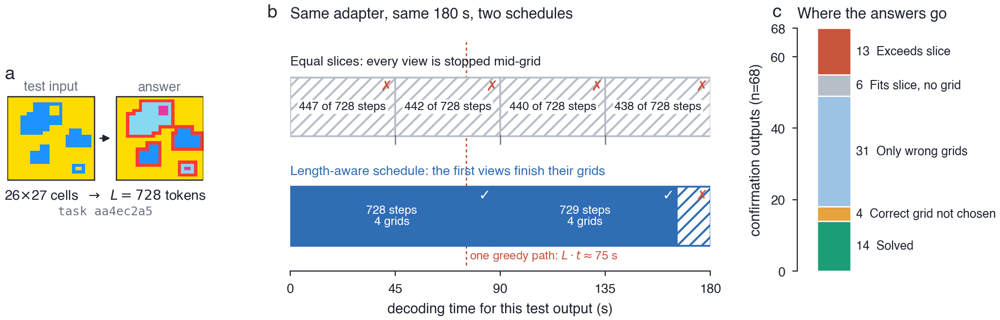
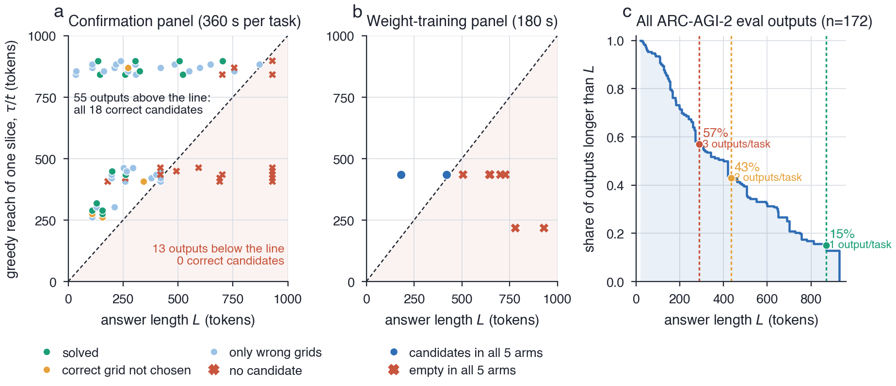
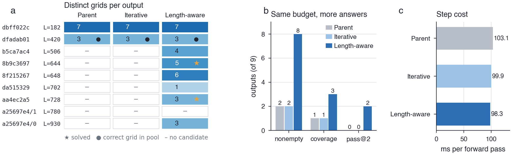
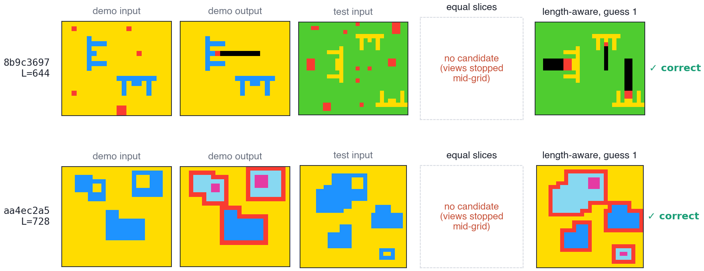
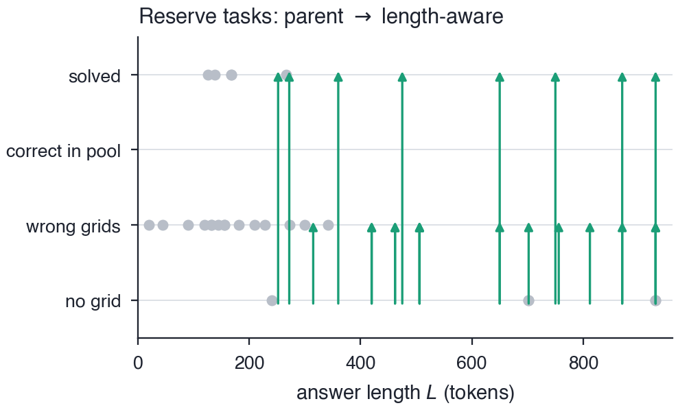

# Out of Time: Where Test-Time-Trained ARC-AGI-2 Solvers Lose Their Answers

**Subtitle:** A one-line decoding bound explains missing candidates; length-aware decoding recovers them at equal cost.

**Author:** Jingtao Huang (Kaggle: huangjt66)

**Paper (PDF):** attached, `main.pdf` · **Code:** https://github.com/huanji2tong/arc-prize-2026-out-of-time (MIT-0)

---

## Abstract

Before a model can be right about an ARC-AGI-2 task, it has to finish writing the answer. Replaying the frozen candidate pools of a working Kaggle entry on 68 held-out outputs, eight different selectors solve the same 14, and only 18 pools contain the answer at all: generation, not selection, sets the ceiling. An h×w grid takes hw+h sequential decoding steps, and splitting a fixed budget evenly across view batches can leave no batch enough time for a long answer. None of the 13 outputs that violate this bound has a correct candidate, and under the same budget 28% of all ARC-AGI-2 public evaluation outputs cannot be decoded at all. **Length-aware decoding** (an exact, recursion-free reimplementation of the solver's DFS plus a first-descent schedule) reduces empty candidate pools from 7/9 to 1/9 and solves 2 outputs the original search cannot reach, with the same model, the same 180 seconds, and no losses. On 32 untouched reserve tasks, pass@2 moves from 5 to 13 of 48 outputs.

## 1. Introduction

ARC-AGI measures how efficiently a system acquires a new skill from a few examples. The strongest open approach for ARC-AGI-2 adapts a language model to each task (test-time training), decodes candidate grids with a probability-thresholded depth-first search over augmented views, and rescores them to pick two guesses (Franzen et al., 2025; NVARC, 2025). We asked where such an entry loses its answers. Saved candidate pools answer this exactly: if the correct grid is in the pool, the loss belongs to selection; otherwise, to generation.

## 2. Prior work

Test-time training for ARC (Akyürek et al.; Cole & Osman), DFS sampling with product-of-experts rescoring (Franzen et al.), synthetic-data training (NVARC), and speculative DFS speedups (the ARChitects, 2025). Our contribution is complementary to faster kernels: we show how the division of a fixed budget among views interacts with answer length to decide which outputs can receive any candidate.

## 3. Approach

* **Coverage–selection decomposition.** pass@2 = coverage × selection, measured by replaying eight selectors on frozen pools; occurrence-count rankings are provably sensitive to duplicated records, view-based ones are not.
* **The decoding clock (Proposition 2).** Under lockstep threshold DFS with t seconds per call, a batch with slice τ can record an L-token candidate only if L·t ≤ τ − prefill. With equal slicing τ = B/(4m).
* **Length-aware decoding.** (i) An iterative DFS that reproduces the parent search exactly (identical suffixes, scores and call counts in 200 tests) without recursion-depth limits and with ARC-only host transfers. (ii) A per-output ledger plus *first-descent extension*: a view may run past its slice only while it is still on its first greedy descent and nothing has finished. Outputs whose first view already succeeds are never extended.

## 4. Results

| Entry (Kaggle ARC-AGI-2, public leaderboard) | Submission ID | Status | Score |
|---|---|---|---|
| Upstream notebook V1 (Rudra) | — | author | 33.89 |
| Our V1 reproduction | 57771030 | in competition | 30.97 |
| B0: 360 s decoding, reference selector | 57948827 | late | 25.28 |
| S1: B0 + NLL-only selector | 57949528 | late | 22.78 |
| S2: B0 + anchored coverage selector | 57950076 | late | 23.61 |
| **L1: B0 + length-aware decoding** | **57972943** | late | **26.94** |

* **Selection is near its ceiling:** all eight selectors solve 14/68; only 4 correct grids are left unselected. Both selector changes scored below B0 on the hidden set.
* **The clock explains missing candidates:** the 13 outputs beyond one slice's greedy reach have zero correct candidates; the 55 within reach hold all 18. 48 of 172 public evaluation outputs are undecodable under a 360 s budget.
* **Null results, re-read:** on our weight-training panel only 2/9 outputs fit a slice, so five training/decoding interventions could change at most two outputs.
* **Matched pilot (same adapter, 180 s per arm):** empty pools 7 → 1, coverage 1 → 3, pass@2 0 → 2, 0 losses, time ratio 0.999; iterative DFS matched the parent on 12/12 undeadlined views at 99.9 vs 103.1 ms per step.
* **Reserve-task confirmation (32 unseen tasks, 48 outputs):** pass@2 5 → 13 (8 gains, 0 losses; 95% task-bootstrap CI [6.0, 29.8] pp), empty pools 28 → 5, coverage 5 → 13.
* **Hidden test set (post-deadline, matched 360 s budget):** length-aware decoding (**L1**, submission `57972943`) scores **26.94** versus **25.28** for the matched control (**B0**, submission `57948827`), a **+1.66** point improvement on the official hidden evaluation set with the same model, adaptation steps, decoding budget, and selector.

## 5. Conclusion

A working test-time-trained ARC-AGI-2 solver loses most answers before selection begins. A one-line bound on sequential decoding explains a large part of this gap, the null results of several training changes, and a property of the benchmark: under a common budget split, more than a quarter of ARC-AGI-2 evaluation outputs cannot be decoded at all. Letting each output finish its first greedy path recovers candidates that equal slicing destroys, at no extra cost.

## Links

* Linked entry (L1): https://www.kaggle.com/code/huangjt66/arc2-paper-l1-length-aware-decoding
* Matched control (B0): https://www.kaggle.com/code/huangjt66/arc2-paper-b0-matched-control
* Code, notebooks and frozen records: https://github.com/huanji2tong/arc-prize-2026-out-of-time (MIT-0; upstream modules Apache-2.0), also attached as `arc-prize-2026-out-of-time.zip`
